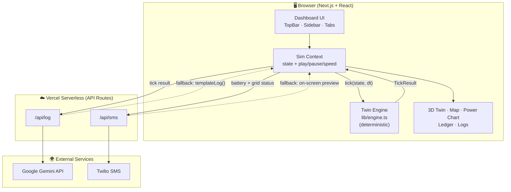
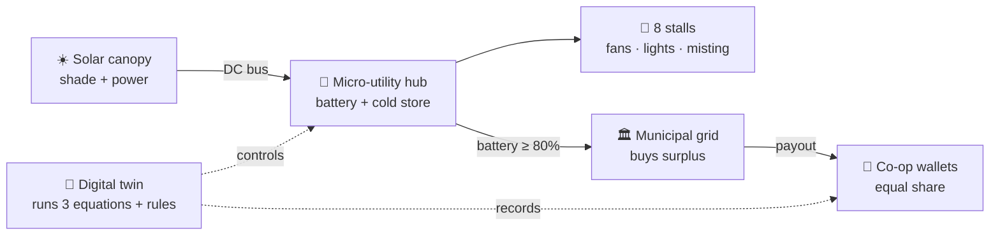
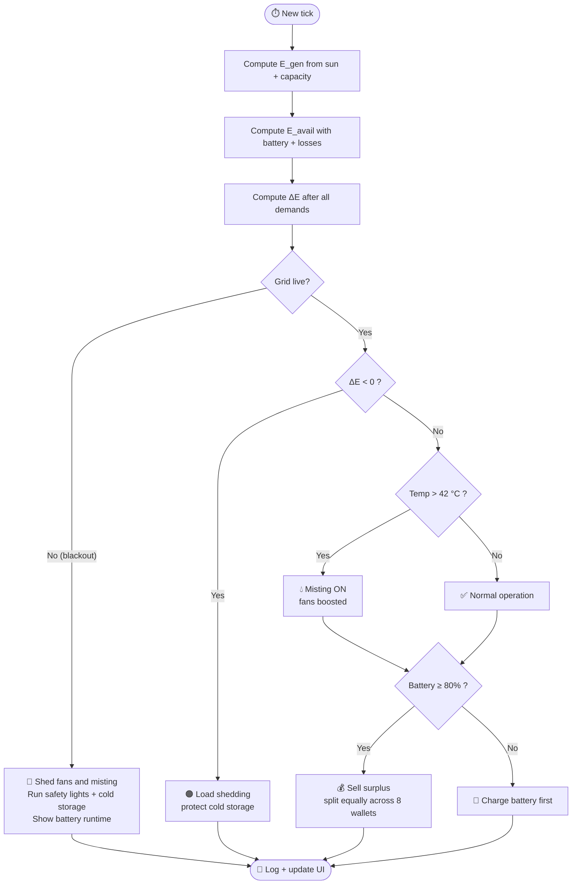
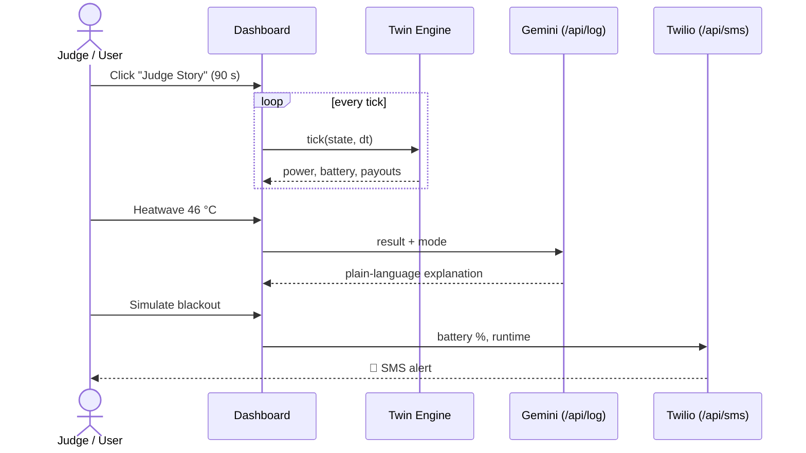

<div align="center">

# ☀️ The Solar Shade Grid

### Urban Canopy Micro-Utility & Virtual Ledger — a live digital twin of a solar-powered street market

**[🔴 Live Demo](https://the-solar-shade-grid.vercel.app/)** · **[Quick Start](#-quick-start)** · **[Architecture](#-architecture)** · **[USP](#-unique-selling-points)**


*Built in 36 hours at **AARAMBH – The Beginning**, organised by Tech Vedas, Dept. of CSE (AI & DS), School of Engineering, Dayananda Sagar University.*

</div>

---

## 📸 Screenshots

> Add your screenshots to a `docs/` folder and update the file names below.

| Normal day | Heatwave (46 °C) | Blackout |
|---|---|---|
|  |  |  |

---

## 🧭 The Problem

Open-air street markets face three linked problems:

1. **Heat.** Vendors work without shade, and fresh produce spoils quickly at 40 °C+.
2. **Power cuts.** Blackouts switch off fans, lights and cold storage.
3. **No shared infrastructure.** Each vendor runs separate, costly power backup, and nobody earns from surplus energy.

## 💡 Our Solution

Solar canopies are installed over the stalls. They give **shade and power at the same time**. All the canopies feed one **shared micro-utility hub** (LiFePO4 battery, cold storage, inverter). A **digital twin** decides in real time where each unit of energy goes, and pays any surplus out **equally to every vendor's wallet**.

> ⚠️ **This repository is a simulation and prototype.** It models the system with equations and virtual (₹) wallets. It is not a deployed hardware system.

---

## ✨ Features

| Feature | What it does |
|---|---|
| 🌐 **3D / 2D Digital Twin** | Orbit, zoom and click the canopy, hub and stalls |
| ⚡ **Live Power Flow chart** | Solar generation vs demand over the last 48 ticks |
| 🌡️ **Heatwave scenario (46 °C)** | Misting turns on and stall fans work harder |
| 🔌 **Blackout scenario** | Load shedding keeps safety lights and cold storage alive; shows battery runtime |
| 💰 **Virtual Ledger** | 8 stall wallets plus a co-op pool, with equal surplus payouts |
| 🤖 **AI Energy Analyst** | Plain-language explanation of every decision (Gemini, with a rule-based fallback) |
| 📱 **SMS alerts** | Battery and grid alerts through Twilio (with an on-screen preview if not configured) |
| 🎬 **90-second Judge Story** | One click plays the whole journey automatically |
| 🧮 **Live Math tab** | The 3 equations with the real numbers of the current tick |
| 🛠️ **Install tab** | Animated 5-step guide to installing the canopy |

---

## 🧮 The Maths (Digital Twin Engine)

```text
1. Micro-generation     E_gen   = P_cap × H_sun × η_eff
2. Battery availability E_avail = E_gen + (B_cap × SOC) − L_loss
3. Net energy delta     ΔE      = E_avail − ΣD_vendor − D_storage − D_cooling
```

| Symbol | Meaning | Demo value |
|---|---|---|
| `P_cap` | Canopy capacity | 12 kW |
| `H_sun` | Sunlight factor, `max(0, sin(π(hour−6)/12))` | 0 – 1 |
| `η_eff` | System efficiency | 0.82 |
| `B_cap` | Battery capacity | 20 kWh |
| `SOC` | Battery state of charge | 0 – 100 % |
| `L_loss` | Inverter and wiring loss | small |

**Rules the engine applies**

- `ΔE < 0` triggers **load shedding**: fans and misting are paused to protect cold storage.
- Misting turns on above **42 °C**.
- Surplus is sold and paid out **only when the battery is ≥ 80 %**, so stored energy is never counted as profit.
- The engine is **deterministic**: the same inputs always give the same outputs.

---

## 🏗️ Architecture



> 🔐 API keys live **only on the server** (environment variables). They are never sent to the browser or stored in the repo.

### Energy flow



### Decision flow (every tick)



### User journey



---

## 🧰 Software Stack

| Layer | Technology | Why we chose it |
|---|---|---|
| **Framework** | Next.js 16 (App Router, Turbopack) | One project for the UI and the API routes |
| **UI library** | React, TypeScript | Type-safe and component-based |
| **Styling** | Tailwind CSS v4, shadcn/ui (Radix) | Fast, consistent, accessible UI |
| **Animation** | Framer Motion, CSS and SVG animation | Smooth transitions, reduced-motion fallbacks |
| **Charts** | Recharts | Live power-flow chart |
| **Icons** | lucide-react | Clean icon set |
| **Simulation engine** | Pure TypeScript (`lib/engine.ts`) | Deterministic and testable, with no random values |
| **AI** | Google Gemini (`@google/genai`) | Plain-language explanations, rule-based fallback |
| **SMS** | Twilio | Real alerts, preview fallback |
| **Hosting** | Vercel | Free tier, instant deploys |
| **Version control** | Git and GitHub | Team collaboration |
| **Dev tools** | VS Code, Google Antigravity, Claude | AI-assisted build under a 36-hour limit |

---

## 📁 Project Structure

```text
The-Solar-Shade-Grid-/
├── app/
│   ├── api/
│   │   ├── log/route.ts      # Gemini explanation (falls back to template)
│   │   └── sms/route.ts      # Twilio SMS (falls back to preview)
│   ├── layout.tsx
│   ├── page.tsx              # Main dashboard + tabs
│   └── globals.css
├── components/
│   ├── TopBar.tsx            # Clock, LIVE, battery, pool, scenarios
│   ├── Sidebar.tsx           # Live ledger of 8 stalls
│   ├── MarketMap.tsx         # 2D map view
│   ├── PowerChart.tsx        # Generation vs demand
│   ├── LogTerminal.tsx       # Typewriter co-op logs
│   ├── StoryOverlay.tsx      # 90-second Judge Story
│   ├── SmsPreview.tsx
│   ├── InstallTab.tsx        # Animated install steps
│   ├── LiveMathTab.tsx       # Equations with live numbers
│   └── AnimatedNumber.tsx
├── lib/
│   ├── engine.ts             # ⚙️ Deterministic twin engine
│   ├── sim-context.tsx       # Simulation state + controls
│   └── story.ts              # Scripted demo scenes
├── docs/                     # Screenshots
└── .env.local                # 🔒 Your keys (not committed)
```

---

## 🚀 Quick Start

**Requirements:** Node.js 20+ and npm.

```bash
# 1. Clone
git clone https://github.com/dishanth24/The-Solar-Shade-Grid-.git
cd The-Solar-Shade-Grid-

# 2. Install
npm install

# 3. Add environment variables (see below)

# 4. Run
npm run dev
```

Open **http://localhost:3000**.

### 🔑 Environment variables

Create a file named `.env.local` in the project root. **Never commit it.**

```env
# Optional: AI explanations (the app works without them, using a rule-based fallback)
GEMINI_API_KEY=your_key_here
GEMINI_MODEL=your_model_name_here

# Optional: real SMS (the app shows an on-screen preview if these are missing)
TWILIO_ACCOUNT_SID=your_sid_here
TWILIO_AUTH_TOKEN=your_token_here
TWILIO_FROM=+1xxxxxxxxxx
DEMO_PHONE=+91xxxxxxxxxx
```

### 🏭 Production build

```bash
npm run build
npm start
```

---

## 🎮 How to Demo (90 seconds)

1. Open the live demo.
2. Click **Judge Story (1:30)** and let it play, or:
3. Try the scenarios by hand: **Normal Grid → Heatwave Peak (46 °C) → Simulate Blackout**.
4. Open the **Live Math** tab to see the real equation values.
5. Open the **Install** tab to see the 5 installation steps.

---

## 🏆 Unique Selling Points

1. **Shade and power in one structure.** One canopy cools the vendor and powers the stall.
2. **Shared hub, not individual backups.** One battery and cold store serve 8 vendors, which is cheaper and more efficient.
3. **Fair by design.** Surplus income is split equally, so no vendor is left out.
4. **Protects what matters in a blackout.** Safety lights and cold storage keep running while fans and misting are shed.
5. **Transparent maths.** The three equations are shown live with real numbers, with no black box.
6. **Honest AI.** The AI label only shows when Gemini actually answered, and there is always a rule-based fallback.
7. **Deterministic and testable.** The same inputs always give the same outputs.
8. **Judge-ready.** A 90-second scripted story plays the whole journey from one click.

## ✅ Advantages

| For | Benefit |
|---|---|
| 👩‍🌾 **Vendors** | Cooler stalls, less spoilage, and a share of the energy income |
| 🏙️ **Cities** | Cleaner power, less load on the grid at peak hours, and a template that can be copied |
| 🌍 **Environment** | Solar replaces diesel generators and cuts emissions |
| 🔧 **Operators** | A digital twin lets you test heatwaves and outages before building |
| 💸 **Cost** | Shared infrastructure costs less per vendor than separate systems |
| 📈 **Scalability** | The same pattern works for any open market, bus stand or food street |

## ⚠️ Limitations (honest scope)

- It is a **simulation**. There is no real hardware, sensors or money involved.
- Wallets and tariff (₹6/kWh) are **virtual**.
- The demo steps **0.25 h per tick** for speed, and the slide equations use a 1 h step.
- A real pilot would need to measure actual stall temperatures, solar output and vendor load.

## 🛣️ Roadmap

- [ ] Persistent ledger with Supabase
- [ ] Real sensor data input (IoT)
- [ ] Mobile-friendly vendor wallet app
- [ ] Multi-market comparison
- [ ] Hardware pilot in one market

---

## 👥 Team

| Name | Branch |
|---|---|
| **Dishanth Surya Tej** | AI & DS |
| **N. Ravindra Reddy** | AI & DS |
| **Sanika K S** | CSE |
| **Varshini** | CSE |

Built at **AARAMBH – The Beginning** (2–3 November 2026), a 36-hour hackathon by **Tech Vedas**, Dept. of CSE (AI & DS), School of Engineering, Dayananda Sagar University.

---

<div align="center">

**☀️ Shade the vendor. Power the market. Share the surplus. ☀️**

</div>
